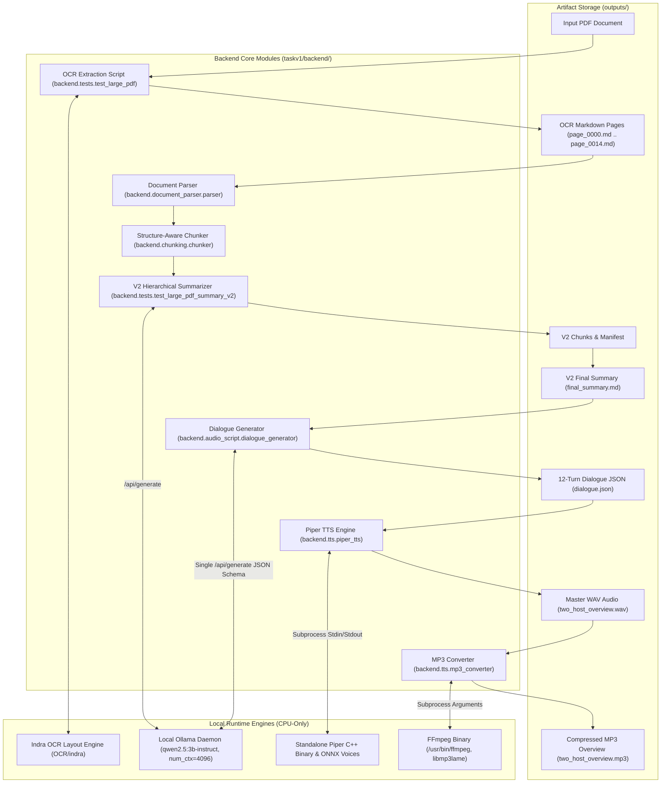

# PDF Audio Overview Generator

> **Transform dense technical PDFs into engaging, natural two-host conversational audio overviews on commodity CPU hardware.**

[](https://www.python.org/)
[-green.svg)]()
[-orange.svg)](https://ollama.ai/)
[-red.svg)](https://github.com/rhasspy/piper)
[-brightgreen.svg)](https://ffmpeg.org/)
[-success.svg)]()

---

## AI SESSION HANDOFF — READ BEFORE CONTINUING

> [!IMPORTANT]
> **MANDATORY INSTRUCTIONS FOR FUTURE AI AGENTS / ANTIGRAVITY SESSIONS**
>
> 1. **Primary Context Authority:** This `README.md` is the single comprehensive source of truth for project status, architecture, and constraints. Do **not** rely on previous conversational memory or attempt to reconstruct context from scratch.
> 2. **Code as Source of Truth:** Always inspect and verify against actual source code (`backend/`) before proposing changes or executing commands.
> 3. **Preserve Baseline Assets:** **NEVER** overwrite, delete, truncate, or regenerate files under `outputs/large_pdf/` (including OCR pages, parser dumps, legacy summaries, and the V2 summary `outputs/large_pdf/summary_v2/final_summary.md`), nor the verified artifacts under `outputs/dialogue_generation_test/`.
> 4. **No Unsanctioned Execution:** Do **NOT** execute Ollama inference, Piper synthesis, FFmpeg conversion, OCR, unit tests, or full pipelines unless the user explicitly authorizes that exact operation.
> 5. **Identify the Exact Current Checkpoint:**
>    - **Completed & Verified:** V2 hierarchical summarization producing [`outputs/large_pdf/summary_v2/final_summary.md`](file:///home/dev/projects/pdf_audio_generator/taskv1/outputs/large_pdf/summary_v2/final_summary.md).
>    - **Completed & Verified:** Single-LLM structured dialogue generator ([`backend/audio_script/dialogue_generator.py`](file:///home/dev/projects/pdf_audio_generator/taskv1/backend/audio_script/dialogue_generator.py)) producing 12-turn dialogue ([`outputs/dialogue_generation_test/dialogue.json`](file:///home/dev/projects/pdf_audio_generator/taskv1/outputs/dialogue_generation_test/dialogue.json)).
>    - **Completed & Verified:** Standalone dual-voice Piper TTS engine ([`backend/tts/piper_tts.py`](file:///home/dev/projects/pdf_audio_generator/taskv1/backend/tts/piper_tts.py)) with sequential generation, 0.3s pause insertion, streaming WAV merge, and atomic commits.
>    - **Completed & Verified:** Complete 12-turn dialogue WAV synthesis producing [`outputs/dialogue_generation_test/two_host_overview.wav`](file:///home/dev/projects/pdf_audio_generator/taskv1/outputs/dialogue_generation_test/two_host_overview.wav) (127.925s, 5,641,538 bytes, 22,050 Hz 16-bit mono PCM).
>    - **Completed & Verified:** Bundled Piper TTS runtime and voice models migrated locally into `tools/piper/` and verified with full 12-turn dialogue synthesis ([`outputs/local_piper_migration_test/two_host_overview.wav`](file:///home/dev/projects/pdf_audio_generator/taskv1/outputs/local_piper_migration_test/two_host_overview.wav)).
>    - **Completed & Verified:** Standalone WAV-to-MP3 converter module ([`backend/tts/mp3_converter.py`](file:///home/dev/projects/pdf_audio_generator/taskv1/backend/tts/mp3_converter.py)) using FFmpeg `libmp3lame` and atomic staging.
>    - **Completed & Verified:** Full dialogue MP3 compression producing [`outputs/dialogue_generation_test/two_host_overview.mp3`](file:///home/dev/projects/pdf_audio_generator/taskv1/outputs/dialogue_generation_test/two_host_overview.mp3) (127.925s, 2,560,566 bytes, 22,050 Hz mono MP3). Source WAV SHA-256 verified unchanged.
> 6. **Immediate Next Tasks (Pending Implementation):**
>    - **End-to-End Orchestrator Script:** Implement a single-command pipeline script (`run_pipeline.py`) that cleanly coordinates Stages 1 through 5 with resume capability.
>    - **FastAPI Backend Server:** Build async REST API endpoints for document upload, pipeline triggering, and audio streaming.
>    - **React Frontend Web UI:** Build a responsive web application for paper upload, progress monitoring, and podcast playback.
> 7. **Handoff Documentation Discipline:** After completing any major milestone, update this `README.md` with:
>    - What changed and exact files created or modified.
>    - Commands executed and verification results.
>    - New output paths and current checkpoint status.
>    - The next concrete, scoped step.

---

## Table of Contents

- [A. Project Overview](#a-project-overview)
- [B. System Architecture](#b-system-architecture)
- [C. Technology Stack](#c-technology-stack)
- [D. Detailed Implementation and Execution Guide](#d-detailed-implementation-and-execution-guide)
  - [Stage 1: PDF Text Extraction & OCR](#stage-1-pdf-text-extraction--ocr)
  - [Stage 2: Hierarchical Summarization (V2)](#stage-2-hierarchical-summarization-v2)
  - [Stage 3: Two-Host Dialogue Script Generation](#stage-3-two-host-dialogue-script-generation)
  - [Stage 4: Dual-Voice Neural TTS Synthesis (WAV)](#stage-4-dual-voice-neural-tts-synthesis-wav)
  - [Stage 5: Standalone WAV-to-MP3 Conversion](#stage-5-standalone-wav-to-mp3-conversion)
  - [Stage 6: Manual End-to-End Workflow Execution](#stage-6-manual-end-to-end-workflow-execution)
- [E. Project Structure](#e-project-structure)
- [F. Configuration and Environment Setup](#f-configuration-and-environment-setup)
- [G. Current Verified Outputs](#g-current-verified-outputs)
- [H. Hardware and Design Constraints](#h-hardware-and-design-constraints)
- [I. Practical Troubleshooting Guide](#i-practical-troubleshooting-guide)
- [J. Project Status and Development Roadmap](#j-project-status-and-development-roadmap)
- [K. Development Guidelines and Safety Rules](#k-development-guidelines-and-safety-rules)

---

## A. Project Overview

### Problem Statement
Technical and scientific papers (e.g., machine learning and systems research) are dense, heavily formatted with mathematical equations and tables, and exhausting to absorb during commutes or away from a desk. Conventional document-to-speech tools rely on robotic, monotonic single-voice TTS readers that lack conversational pacing, critical questioning, and natural vocal variety.

### Project Motivation & Objectives
The **PDF Audio Overview Generator** converts technical PDF papers into lively, educational, podcast-style discussions between two specialized virtual hosts:
1. **Host 1 — Explainer (`speaker-1`):** Leads the narrative, introduces core concepts clearly, systematically breaks down mechanisms and equations, and connects ideas into a coherent story.
2. **Host 2 — Curious Analyst (`speaker-2`):** Asks sharp probing questions, highlights practical trade-offs and limitations, draws clarifying analogies, and prevents monologue fatigue.

### Core Architecture Highlights
- **100% Local & Private:** Runs entirely on local hardware with zero cloud API dependencies, zero external per-token costs, and zero data leakage.
- **CPU & Low-RAM Optimization:** Engineered specifically to run on commodity 6-core CPUs with only 8 GB RAM and no discrete GPU.
- **Single-LLM Structured Dialogue:** Employs constrained JSON Schema decoding on local Ollama to plan and generate the entire balanced conversation in **one single inference pass** (~50 seconds), completely avoiding multi-agent latency, round-trip overhead, and narrative drift.
- **Dual-Voice Neural Synthesis:** Uses local C++ Piper ONNX models (`en_US-lessac-medium` and `en_US-hfc_female-medium`) with sequential generation to prevent CPU thrashing.
- **Low-Footprint Streaming Audio Merging:** Assembles turn audio into a master WAV container using 4,096-frame buffers (<20 KB RAM), inserting natural 0.3-second inter-turn pauses.
- **High-Quality MP3 Compression:** Integrates system FFmpeg via standard library `subprocess` with `libmp3lame`, reducing audio footprint by ~55% while preserving full audio fidelity.
- **Race-Safe Atomic Commits:** Employs Linux kernel-level atomic hard-linking (`os.link`) for all staged outputs when `overwrite=False`, guaranteeing existing files are never corrupted or accidentally truncated.

### Current Implementation Status
All backend processing stages (Stages 1 through 5) are **fully implemented and verified in isolation**. The complete asset chain—from raw PDF through OCR, V2 summary, 12-turn dialogue JSON, dual-voice WAV overview, to compressed MP3 overview—has been generated and verified. The remaining milestones are building an automated end-to-end CLI orchestrator script, REST API endpoints (FastAPI), and a web UI (React).

---

## B. System Architecture



### Architectural Separation & Current Reality
- **Implemented & Independently Verified:**
  - Stage 1: OCR page extraction via `indra_ocr`.
  - Stage 2: Structural document parsing, semantic chunking, and V2 hierarchical summarization.
  - Stage 3: Single-LLM structured two-host dialogue generation and JSON Schema enforcement.
  - Stage 4: Standalone Piper TTS dual-voice synthesis, streaming frame merging, pause insertion, and WAV validation.
  - Stage 5: Standalone WAV-to-MP3 compression using FFmpeg `libmp3lame` and atomic staging.
- **Workflow State:**
  - Stages currently run via verified Python entry points or standalone script commands.
  - An automated one-command pipeline orchestrator (`run_pipeline.py`) that wires Stages 1–5 end-to-end is planned next.
- **Planned Outer Layers:**
  - FastAPI asynchronous REST endpoints.
  - React modern frontend web UI.

---

## C. Technology Stack

### Verified Local Technologies
| Technology | Role | Verified Version / Details | Project Location |
|---|---|---|---|
| **Python** | Core runtime | 3.11.18 (`conda` environment `pdf-audio`) | System path |
| **Ollama** | Local LLM server | Local HTTP service on port 11434 | `http://localhost:11434/api/generate` |
| **Qwen 2.5 3B Instruct** | Dialogue writing & summarization | `qwen2.5:3b-instruct` (Q4_K_M, ~2.2 GB RAM, `num_ctx=4096`) | Ollama local model storage |
| **Piper TTS (Standalone C++)** | Local neural speech synthesis | x86_64 standalone binary (bundled) | `tools/piper/piper/piper` |
| **Piper ONNX Voices** | Medium neural voices | `en_US-lessac-medium`, `en_US-hfc_female-medium` (bundled) | `tools/piper/models/` |
| **FFmpeg** | Audio compression & muxing | 8.0.1-3ubuntu2 with `libmp3lame` | `/usr/bin/ffmpeg` |
| **FFprobe** | Audio stream & container inspection | 8.0.1-3ubuntu2 | `/usr/bin/ffprobe` |
| **Python `wave`** | Native WAV container validation & merging | Standard Library | `backend/tts/piper_tts.py` |
| **Python `subprocess`** | Process isolation for Piper & FFmpeg | Standard Library | `backend/tts/` |
| **Python `urllib.request`** | Stateless HTTP communication with Ollama | Standard Library | `backend/audio_script/dialogue_generator.py` |
| **indra_ocr** | Document layout analysis & OCR | Installed in development mode | `OCR/indra` |

### Planned Technologies
| Technology | Intended Role | Current Status |
|---|---|---|
| **FastAPI** | REST API serving PDF upload, task status, audio streaming | Planned |
| **Uvicorn** | ASGI web server for FastAPI | Planned |
| **React** | Web frontend for document upload & audio player | Planned |

---

## D. Detailed Implementation and Execution Guide

### Stage 1: PDF Text Extraction & OCR

#### 1. Purpose
Extracts dense technical PDF documents (including multi-column layouts, mathematical equations, and embedded tables) into clean, sequential Markdown page files.

#### 2. Input & Output
- **Input:** Raw PDF file (e.g., reference benchmark `"Attention Is All You Need"`).
- **Output:** Directory of Markdown page files: `outputs/large_pdf/pages/page_0000.md` through `page_0014.md`, and checkpoint state in `outputs/large_pdf/state.json`.

#### 3. Main Source Files
- [`OCR/indra/`](file:///home/dev/projects/pdf_audio_generator/taskv1/OCR/indra) (installed in development mode).
- [`backend/tests/test_large_pdf.py`](file:///home/dev/projects/pdf_audio_generator/taskv1/backend/tests/test_large_pdf.py) (extraction script).

#### 4. Important Functions & Signatures
```python
def extract_pdf(pdf_path: Path, reset: bool = False) -> None:
    """Extract all PDF pages into individual page_XXXX.md files with resumable checkpointing."""
```

#### 5. Configuration & Prerequisites
- Python environment with `indra_ocr` installed (`pip install -e ./OCR/indra`).
- Optional environment variable: `INDRA_OCR_MODEL_DIR` in [`backend/config.py`](file:///home/dev/projects/pdf_audio_generator/taskv1/backend/config.py).

#### 6. Verified Execution Command
> [!CAUTION]
> OCR is compute-heavy on CPU. The reference pages under `outputs/large_pdf/pages/` are verified baseline assets and must **never** be rerun or overwritten without explicit user instruction.

```bash
python3 backend/tests/test_large_pdf.py /path/to/paper.pdf
```
To restart from scratch:
```bash
python3 backend/tests/test_large_pdf.py /path/to/paper.pdf --reset
```

#### 7. Verification
Confirm that `outputs/large_pdf/pages/` contains sequentially indexed files (`page_0000.md`, `page_0001.md`, ...) with non-zero size.

#### 8. Current Limitations
Currently implemented as a utility test script in `backend/tests/test_large_pdf.py`. It is not yet wrapped as a production CLI tool or FastAPI service.

---

### Stage 2: Hierarchical Summarization (V2)

#### 1. Purpose
Parses extracted Markdown pages into structured document objects, semantic section chunks, and hierarchical summaries. Employs multi-pass reduction to generate a compact, technically rigorous summary preserving equations, BLEU scores, and architectural mechanisms.

#### 2. Input & Output
- **Input:** 15 Markdown page files from `outputs/large_pdf/pages/`.
- **Output:**
  - Serialized document structure: `outputs/large_pdf/parser/document_structure.json`.
  - 11 section chunk summaries: `outputs/large_pdf/summary_v2/chunks/chunk_000.md` .. `chunk_010.md`.
  - Chunk manifest: `outputs/large_pdf/summary_v2/chunks_metadata.json`.
  - Reconciled final summary: [`outputs/large_pdf/summary_v2/final_summary.md`](file:///home/dev/projects/pdf_audio_generator/taskv1/outputs/large_pdf/summary_v2/final_summary.md) (2,167 bytes, 4 dense paragraphs).

#### 3. Main Source Files
- [`backend/document_parser/parser.py`](file:///home/dev/projects/pdf_audio_generator/taskv1/backend/document_parser/parser.py): Parses raw Markdown into rich sections and content blocks.
- [`backend/chunking/chunker.py`](file:///home/dev/projects/pdf_audio_generator/taskv1/backend/chunking/chunker.py): Structure-aware chunking preserving atomic tables and section boundaries.
- [`backend/tests/test_large_pdf_summary_v2.py`](file:///home/dev/projects/pdf_audio_generator/taskv1/backend/tests/test_large_pdf_summary_v2.py): V2 hierarchical summarization pipeline script.

#### 4. Important Functions & Signatures
```python
# backend/document_parser/parser.py
def parse_markdown_pages(pages: list[tuple[int, str]]) -> ParsedDocument: ...

# backend/chunking/chunker.py
def chunk_document(
    doc: ParsedDocument,
    target_size: int = 5000,
    max_size: int = 6000,
) -> list[DocumentChunk]: ...
```

#### 5. Configuration & Prerequisites
- Local Ollama running with `qwen2.5:3b-instruct`:
  ```bash
  curl -s http://localhost:11434/api/tags | grep qwen2.5:3b-instruct
  ```
- Configuration parameters in `backend/config.py`: `OLLAMA_URL`, `MODEL_NAME`, `NUM_CTX` (4096), `CHUNK_TARGET_SIZE` (5000), `CHUNK_MAX_SIZE` (6000).

#### 6. Verified Execution Command
```bash
PYTHONPATH=. python3 backend/tests/test_large_pdf_summary_v2.py
```

#### 7. Verification
Verify that `outputs/large_pdf/summary_v2/final_summary.md` exists and contains ~2,100 characters detailing the Transformer architecture, attention formulas, regularization, and BLEU results.

#### 8. Current Limitations
Operates as a pipeline script inside `backend/tests/test_large_pdf_summary_v2.py`. While fully resumable via `state.json`, it is not yet parameterized for arbitrary input paths via CLI arguments.

---

### Stage 3: Two-Host Dialogue Script Generation

#### 1. Purpose
Transforms the dense research summary into a structured, natural podcast dialogue between an Explainer (`speaker-1`) and a Curious Analyst (`speaker-2`) using **one single LLM inference call** with token-level JSON Schema constraints.

#### 2. Input & Output
- **Input:** Research summary text (e.g. from `outputs/large_pdf/summary_v2/final_summary.md`).
- **Output:** Validated JSON dialogue array matching `DIALOGUE_JSON_SCHEMA`:
  [`outputs/dialogue_generation_test/dialogue.json`](file:///home/dev/projects/pdf_audio_generator/taskv1/outputs/dialogue_generation_test/dialogue.json) (12 turns, 2,865 bytes).

#### 3. Main Source Files
- [`backend/audio_script/dialogue_generator.py`](file:///home/dev/projects/pdf_audio_generator/taskv1/backend/audio_script/dialogue_generator.py)
- [`backend/audio_script/__init__.py`](file:///home/dev/projects/pdf_audio_generator/taskv1/backend/audio_script/__init__.py)

#### 4. Important Functions & Signatures
```python
def build_dialogue_prompt(summary_text: str) -> str:
    """Construct the system instruction and prompt for two-host dialogue writing."""

def validate_dialogue_structure(
    dialogue: list[dict[str, str]],
    min_turns: int = 8,
    max_turns: int = 14,
    min_words_per_turn: int = 12,
    max_words_per_turn: int = 75,
) -> None:
    """Validate dialogue turn counts, speaker alternation, word boundaries, and prefix cleanliness."""

def generate_dialogue_script(
    summary_text: str,
    model_name: str | None = None,
    ollama_url: str | None = None,
    num_ctx: int | None = None,
    temperature: float = 0.3,
    timeout_seconds: int = 300,
) -> list[dict[str, str]]:
    """Execute a single Ollama call with JSON Schema decoding and validate dialogue structure."""
```

#### 5. Rules & Structural Constraints Enforced
1. **Single LLM Call:** Makes exactly one HTTP POST request to Ollama with `"stream": False`.
2. **Schema Enforcement:** Passes `DIALOGUE_JSON_SCHEMA` into Ollama's `format` parameter.
3. **Turn Bounds:** Enforces $8 \le \text{turns} \le 14$ (targeting 10–12 turns).
4. **Word Bounds:** Enforces $12 \le \text{words} \le 75$ per spoken turn. Prevents trivial filler and runaway monologues.
5. **Strict Alternation:** Dialogue must start with `speaker-1` and strictly alternate `speaker-1`, `speaker-2`, `speaker-1`, `speaker-2`, ...
6. **Clean Spoken Text:** Regex prohibits leading speaker prefixes (e.g. `speaker-1:`, `Host:`, `[laughs]`) in spoken text.

#### 6. Verified Python API Invocation Example
```bash
python3 -B -c '
import json
import sys
from pathlib import Path

PROJECT_ROOT = Path(".").resolve()
if str(PROJECT_ROOT) not in sys.path:
    sys.path.insert(0, str(PROJECT_ROOT))

from backend.audio_script.dialogue_generator import generate_dialogue_script

summary_file = PROJECT_ROOT / "outputs" / "large_pdf" / "summary_v2" / "final_summary.md"
summary_text = summary_file.read_text(encoding="utf-8").strip()

dialogue = generate_dialogue_script(
    summary_text=summary_text,
    temperature=0.3,
    timeout_seconds=300,
)

out_file = PROJECT_ROOT / "outputs" / "dialogue_generation_test" / "dialogue.json"
out_file.parent.mkdir(parents=True, exist_ok=True)
out_file.write_text(json.dumps({"dialogue": dialogue}, indent=2), encoding="utf-8")
print(f"Successfully generated and validated {len(dialogue)} turns at {out_file}")
'
```

#### 7. Verification
Run `backend.audio_script.validate_dialogue_structure(dialogue)` to assert 100% compliance with turn bounds, word bounds, and alternating speakers.

---

### Stage 4: Dual-Voice Neural TTS Synthesis (WAV)

#### 1. Purpose
Synthesizes the structured dialogue into a continuous, broadcast-quality WAV audio file using the standalone C++ Piper engine. Maps virtual hosts to distinct neural ONNX voices, generates turns sequentially in a temporary directory, inserts natural 0.3-second pauses, and stream-merges the frames into a master WAV container.

#### 2. Input & Output
- **Input:** Dialogue turns sequence from `outputs/dialogue_generation_test/dialogue.json`.
- **Output:** Master WAV file: [`outputs/dialogue_generation_test/two_host_overview.wav`](file:///home/dev/projects/pdf_audio_generator/taskv1/outputs/dialogue_generation_test/two_host_overview.wav).
  - Size: `5,641,538 bytes` (~5.38 MB).
  - Duration: `127.925 seconds` (~2 min 7.9s).
  - Format: 22,050 Hz, 16-bit signed PCM, 1-channel mono, uncompressed.

#### 3. Main Source Files
- [`backend/tts/piper_tts.py`](file:///home/dev/projects/pdf_audio_generator/taskv1/backend/tts/piper_tts.py)
- [`backend/tts/__init__.py`](file:///home/dev/projects/pdf_audio_generator/taskv1/backend/tts/__init__.py)

#### 4. Important Functions & Signatures
```python
def synthesize_dialogue(
    dialogue_turns: Sequence[Mapping[str, Any] | tuple[Any, ...]],
    output_path: str | Path,
    voice_map: Mapping[str, str] | None = None,
    pause_duration: float = 0.3,
    piper_bin: Path | None = None,
    models_dir: Path | None = None,
    overwrite: bool = False,
) -> Path: ...

def generate_piper_wav(
    text: str,
    voice_name: str,
    output_path: str | Path,
    piper_bin: Path | None = None,
    models_dir: Path | None = None,
    length_scale: float = 1.0,
    timeout_seconds: int = 60,
    overwrite: bool = False,
) -> Path: ...

def combine_wav_files(
    wav_files: Sequence[str | Path],
    output_path: str | Path,
    pause_duration: float = 0.3,
    overwrite: bool = False,
) -> Path: ...

def validate_wav_format(wav_path: Path, label: str = "WAV file") -> tuple[int, int, int]: ...
```

#### 5. Voice Mapping & Pacing Configuration
| Speaker Label / Role | Assigned Voice Model | Model File | Config File |
|---|---|---|---|
| `speaker-1` / `Explainer` | `en_US-lessac-medium` | `tools/piper/models/en_US-lessac-medium.onnx` | `tools/piper/models/en_US-lessac-medium.onnx.json` |
| `speaker-2` / `Curious Analyst` | `en_US-hfc_female-medium` | `tools/piper/models/en_US-hfc_female-medium.onnx` | `tools/piper/models/en_US-hfc_female-medium.onnx.json` |
| **Inter-Turn Pause** | `0.3 seconds` of silence | `max(0, int(22050 * 0.3))` zero-byte PCM frames inserted between turns |

#### 6. Verified Python API Invocation Example
```bash
python3 -B -c '
import json
import sys
from pathlib import Path

PROJECT_ROOT = Path(".").resolve()
if str(PROJECT_ROOT) not in sys.path:
    sys.path.insert(0, str(PROJECT_ROOT))

from backend.tts import synthesize_dialogue, validate_wav_format

input_json = PROJECT_ROOT / "outputs" / "dialogue_generation_test" / "dialogue.json"
output_wav = PROJECT_ROOT / "outputs" / "dialogue_generation_test" / "two_host_overview.wav"

data = json.loads(input_json.read_text(encoding="utf-8"))
dialogue = data["dialogue"]

result = synthesize_dialogue(
    dialogue_turns=dialogue,
    output_path=output_wav,
    pause_duration=0.3,
    overwrite=False,
)

validate_wav_format(result)
print(f"Master WAV generated successfully: {result} ({result.stat().st_size:,} bytes)")
'
```

#### 7. Verification
Run `validate_wav_format(wav_path)` to ensure the generated file strictly conforms to 22,050 Hz, 1-channel mono, 16-bit uncompressed PCM.

---

### Stage 5: Standalone WAV-to-MP3 Conversion

#### 1. Purpose
Compresses the uncompressed master WAV into an optimized MP3 audio file using system FFmpeg with the `libmp3lame` codec. Reduces storage footprint by ~55% while maintaining clear voice intelligibility.

#### 2. Input & Output
- **Input:** Uncompressed master WAV: `outputs/dialogue_generation_test/two_host_overview.wav` (read strictly read-only).
- **Output:** Compressed MP3 file: [`outputs/dialogue_generation_test/two_host_overview.mp3`](file:///home/dev/projects/pdf_audio_generator/taskv1/outputs/dialogue_generation_test/two_host_overview.mp3).
  - Size: `2,560,566 bytes` (~2.44 MB).
  - Duration: `127.925 seconds`.
  - Format: MP3 (`libmp3lame`), 22,050 Hz, 1-channel mono.
  - Bitrate: 160 kbps stream bitrate (see technical note below).

#### 3. Main Source Files
- [`backend/tts/mp3_converter.py`](file:///home/dev/projects/pdf_audio_generator/taskv1/backend/tts/mp3_converter.py)
- [`backend/tts/__init__.py`](file:///home/dev/projects/pdf_audio_generator/taskv1/backend/tts/__init__.py)

#### 4. Important Functions & Signatures
```python
def validate_bitrate(bitrate: str) -> str:
    """Validate and normalize bitrate string (32k to 320k)."""

def convert_wav_to_mp3(
    wav_path: str | Path,
    output_path: str | Path | None = None,
    bitrate: str = "192k",
    ffmpeg_bin: str | Path | None = None,
    overwrite: bool = False,
) -> Path:
    """Convert an uncompressed WAV audio file to MP3 using FFmpeg and libmp3lame.
    
    Stages output into a temporary file in output_path.parent and commits atomically.
    Source WAV is opened strictly read-only and is never modified, deleted, or moved.
    """
```

#### 5. Important Technical Note on MPEG-2 Audio Bitrate Ceiling
When converting 22,050 Hz audio, FFmpeg uses the **MPEG-2 Audio Layer III (LSF)** specification. Under the MPEG-2 ISO specification, the maximum standard CBR bitrate ceiling is **160 kbps** (valid rates: 8, 16, 24, 32, 40, 48, 56, 64, 80, 96, 112, 128, 144, 160 kbps). When `-b:a 192k` is requested for 22,050 Hz audio, LAME automatically and correctly maps it to the maximum allowable standard rate of 160 kbps. FFprobe confirms the resulting file has a stream bitrate of exactly 160,000 bps (container bitrate 160,129 bps).

#### 6. Verified Python API Invocation Example
```bash
python3 -B -c '
import sys
from pathlib import Path

PROJECT_ROOT = Path(".").resolve()
if str(PROJECT_ROOT) not in sys.path:
    sys.path.insert(0, str(PROJECT_ROOT))

from backend.tts import convert_wav_to_mp3

source_wav = PROJECT_ROOT / "outputs" / "dialogue_generation_test" / "two_host_overview.wav"
target_mp3 = PROJECT_ROOT / "outputs" / "dialogue_generation_test" / "two_host_overview.mp3"

result = convert_wav_to_mp3(
    wav_path=source_wav,
    output_path=target_mp3,
    bitrate="192k",
    overwrite=False,
)

print(f"Master MP3 generated successfully: {result} ({result.stat().st_size:,} bytes)")
'
```

#### 7. Verification
Verify with `ffprobe`:
```bash
ffprobe -v error -show_entries format=format_name,duration,bit_rate:stream=codec_name,sample_rate,channels -of json outputs/dialogue_generation_test/two_host_overview.mp3
```

---

### Stage 6: Manual End-to-End Workflow Execution

A developer can currently run through the complete workflow using the existing verified commands and Python entry points:

```
[ Step 1: Extract PDF Pages via OCR ]
$ python3 backend/tests/test_large_pdf.py /path/to/paper.pdf
    -> outputs/large_pdf/pages/page_*.md

[ Step 2: Hierarchical Summarization ]
$ PYTHONPATH=. python3 backend/tests/test_large_pdf_summary_v2.py
    -> outputs/large_pdf/summary_v2/final_summary.md

[ Step 3: Structured Dialogue Generation ]
$ python3 -B -c '
from backend.audio_script.dialogue_generator import generate_dialogue_script
import json, pathlib
summary = pathlib.Path("outputs/large_pdf/summary_v2/final_summary.md").read_text()
dialogue = generate_dialogue_script(summary)
pathlib.Path("outputs/dialogue_generation_test/dialogue.json").write_text(json.dumps({"dialogue": dialogue}, indent=2))
'
    -> outputs/dialogue_generation_test/dialogue.json

[ Step 4: Dual-Voice Neural TTS Synthesis ]
$ python3 -B -c '
from backend.tts import synthesize_dialogue
import json, pathlib
dialogue = json.loads(pathlib.Path("outputs/dialogue_generation_test/dialogue.json").read_text())["dialogue"]
synthesize_dialogue(dialogue, "outputs/dialogue_generation_test/two_host_overview.wav")
'
    -> outputs/dialogue_generation_test/two_host_overview.wav

[ Step 5: Master MP3 Compression ]
$ python3 -B -c '
from backend.tts import convert_wav_to_mp3
convert_wav_to_mp3("outputs/dialogue_generation_test/two_host_overview.wav", "outputs/dialogue_generation_test/two_host_overview.mp3")
'
    -> outputs/dialogue_generation_test/two_host_overview.mp3
```

*Note: In the next phase, an automated pipeline orchestrator will encapsulate these steps into a single CLI command (`python3 run_pipeline.py <paper.pdf>`).*

---

## E. Project Structure

```
/home/dev/projects/pdf_audio_generator/taskv1/
├── .env.example                       # Reference environment variable template
├── .gitignore                         # Git ignore rules (.env, __pycache__, outputs/)
├── PROJECT_CONTEXT.md                 # Baseline architectural context documentation
├── SESSION_HANDOFF.md                 # Historical session handoff log
├── TASK_LOG.md                        # Master task tracking and verification evidence
├── README.md                          # Single source of truth documentation (this file)
│
├── backend/                           # Core backend source modules
│   ├── __init__.py
│   ├── config.py                      # Centralized configuration (env > .env > defaults)
│   ├── requirements.txt               # Backend requirements (-e ./OCR/indra)
│   │
│   ├── audio_script/                  # Dialogue generation package
│   │   ├── __init__.py                # Exports generate_dialogue_script, validate_dialogue_structure
│   │   └── dialogue_generator.py      # Single-LLM structured dialogue generator & validator
│   │
│   ├── chunking/                      # Structure-aware document chunking package
│   │   ├── __init__.py                # Exports DocumentChunk, chunk_document
│   │   └── chunker.py                 # Semantic section coalescing and atomic table handler
│   │
│   ├── document_parser/               # PDF Markdown parsing package
│   │   ├── __init__.py                # Exports parse_markdown_pages, ParsedDocument, Section
│   │   └── parser.py                  # Parses raw OCR markdown into rich object graph
│   │
│   ├── tts/                           # Speech synthesis and audio conversion package
│   │   ├── __init__.py                # Exports Piper synthesis and MP3 converter functions
│   │   ├── piper_tts.py               # Standalone C++ Piper synthesis, streaming merge, atomic commits
│   │   └── mp3_converter.py           # Standalone FFmpeg libmp3lame WAV-to-MP3 converter
│   │
│   └── tests/                         # Unit tests and pipeline scripts
│       ├── test_document_parser.py    # Unit tests for document parser
│       ├── test_chunker.py            # Unit tests for structure-aware chunker
│       ├── test_large_pdf.py          # Indra OCR page extraction script
│       ├── test_large_pdf_summary_v2.py # Hierarchical summarization V2 pipeline script
│       ├── test_qwen.py               # Ollama connectivity test
│       └── test_indra.py              # OCR engine connectivity test
│
├── tools/                             # Self-contained bundled runtime tools
│   └── piper/                         # Standalone Piper C++ TTS engine and voice models
│       ├── piper/                     # Piper x86_64 binary, shared libs, and espeak-ng-data
│       └── models/                    # Bundled ONNX voice models (lessac and hfc_female)
│
├── OCR/                               # OCR engine submodule
│   └── indra/                         # Local indra_ocr package repository
│
└── outputs/                           # Generated project assets (PRESERVE CAREFULLY)
    ├── summary.md                     # 3-page prototype summary (legacy baseline)
    ├── audio_script.md                # Prototype audio script (legacy baseline)
    ├── audio.mp3                      # Prototype gTTS audio (legacy baseline)
    │
    ├── large_pdf/                     # Reference benchmark ("Attention Is All You Need")
    │   ├── pages/                     # 15 OCR extracted pages (page_0000.md .. page_0014.md)
    │   ├── parser/                    # Serialized document_structure.json
    │   ├── summary/                   # Legacy chunk summaries and final_summary.md
    │   └── summary_v2/                # High-fidelity V2 hierarchical summarization assets
    │       ├── chunks/                # 11 section chunk summaries (chunk_000.md .. chunk_010.md)
    │       ├── chunks_metadata.json   # Chunk manifest and verification hashes
    │       ├── state.json             # Pipeline execution state
    │       └── final_summary.md       # Reconciled 2,167-byte V2 summary (VERIFIED BASELINE)
    │
    ├── piper_smoke_test/              # Standalone single-voice Piper tests
    │   ├── host1_test.wav             # Explainer voice (lessac) smoke test (5.44s)
    │   └── host2_test.wav             # Analyst voice (hfc_female) smoke test (4.95s)
    │
    ├── piper_dialogue_test/           # 4-turn dialogue synthesis integration test
    │   └── two_host_dialogue.wav      # Merged WAV with 0.3s pauses (19.09s, 841 KB)
    │
    ├── local_piper_migration_test/    # Verification test for local Piper runtime
    │   └── two_host_overview.wav      # Verified 12-turn dialogue synthesized with local Piper
    │
    └── dialogue_generation_test/      # Controlled 12-turn dialogue generation and master audio
        ├── dialogue.json              # Validated 12-turn dialogue JSON (2,865 bytes)
        ├── two_host_overview.wav      # Full 12-turn dialogue WAV (5,641,538 bytes, 127.925s)
        └── two_host_overview.mp3      # Master compressed MP3 (2,560,566 bytes, 127.925s)
```

---

## F. Configuration and Environment Setup

### System Prerequisites
- **OS:** Linux (Ubuntu 22.04 LTS / 24.04 LTS / 26.04 LTS verified).
- **RAM:** Minimum 8 GB RAM.
- **Python:** Python 3.11 (`conda` environment `pdf-audio` recommended).
- **System Binaries:** `ffmpeg` and `ffprobe` (Ubuntu package `ffmpeg`).

### 1. Conda Environment Activation
```bash
conda activate pdf-audio
cd /home/dev/projects/pdf_audio_generator/taskv1
```

### 2. Local Ollama LLM Setup
Ensure Ollama is running locally on port `11434`:
```bash
# Verify Ollama service and model presence
curl -s http://localhost:11434/api/tags | grep qwen2.5:3b-instruct

# Pull model if missing
ollama pull qwen2.5:3b-instruct
```

### 3. Piper Binary & Models Setup
The Piper C++ synthesis runtime and both ONNX voice models are bundled directly inside this project under `tools/piper/`:
- **Runtime binary & libraries:** `tools/piper/piper/`
- **Neural voice models:** `tools/piper/models/`

Verify bundled files and executable permissions:
```bash
# Verify Piper executable
test -x tools/piper/piper/piper && echo "Piper Binary: OK"

# Verify voice models
test -f tools/piper/models/en_US-lessac-medium.onnx && echo "Host 1 Voice: OK"
test -f tools/piper/models/en_US-hfc_female-medium.onnx && echo "Host 2 Voice: OK"
```

### 4. FFmpeg Verification
```bash
which ffmpeg && ffmpeg -version | head -n 1
ffmpeg -encoders 2>&1 | grep libmp3lame
```

### 5. Environment Variable Reference

Central configuration follows standard precedence: **System Env > Local `.env` > In-code Defaults**.

| Variable | Defined In | Default Value | Purpose |
|---|---|---|---|
| `OLLAMA_URL` | `backend/config.py` | `http://localhost:11434/api/generate` | Local Ollama generate endpoint |
| `MODEL_NAME` | `backend/config.py` | `qwen2.5:3b-instruct` | LLM model identifier |
| `NUM_CTX` | `backend/config.py` | `4096` | Context window size in tokens |
| `CHUNK_TARGET_SIZE` | `backend/config.py` | `5000` | Target character count for semantic chunking |
| `CHUNK_MAX_SIZE` | `backend/config.py` | `6000` | Hard ceiling for section chunking |
| `TTS_LANGUAGE` | `backend/config.py` | `en` | Fallback language code |
| `INDRA_OCR_MODEL_DIR` | `backend/config.py` | `None` | Optional custom checkpoint path for OCR |
| `PIPER_BIN_PATH` | `backend/tts/piper_tts.py` | `tools/piper/piper/piper` | Optional override for Piper binary path (default: project-local) |
| `PIPER_MODELS_DIR` | `backend/tts/piper_tts.py` | `tools/piper/models` | Optional override for Piper models directory (default: project-local) |
| `PIPER_VOICE_EXPLAINER`| `backend/tts/piper_tts.py`| `en_US-lessac-medium` | Voice model for Host 1 (Explainer) |
| `PIPER_VOICE_ANALYST` | `backend/tts/piper_tts.py` | `en_US-hfc_female-medium` | Voice model for Host 2 (Curious Analyst) |
| `PIPER_PAUSE_DURATION` | `backend/tts/piper_tts.py` | `0.3` (seconds) | Duration of silence inserted between dialogue turns |
| `FFMPEG_BIN_PATH` | `backend/tts/mp3_converter.py`| `/usr/bin/ffmpeg` | FFmpeg executable path |

---

## G. Current Verified Outputs

All generated assets are stored in `outputs/` and verified for byte-level integrity:

| Artifact Path | Format | Size | Duration / Turns | Description & Integrity |
|---|---|---|---|---|
| [`outputs/large_pdf/summary_v2/final_summary.md`](file:///home/dev/projects/pdf_audio_generator/taskv1/outputs/large_pdf/summary_v2/final_summary.md) | Markdown | `2,167 bytes` | 4 paragraphs | High-fidelity hierarchical summary of reference paper. |
| [`outputs/dialogue_generation_test/dialogue.json`](file:///home/dev/projects/pdf_audio_generator/taskv1/outputs/dialogue_generation_test/dialogue.json) | JSON | `2,865 bytes` | 12 turns | Validated alternating dialogue (`speaker-1`, `speaker-2`). |
| [`outputs/dialogue_generation_test/two_host_overview.wav`](file:///home/dev/projects/pdf_audio_generator/taskv1/outputs/dialogue_generation_test/two_host_overview.wav) | WAV (PCM) | `5,641,538 bytes` | 127.925 s (2,820,747 frames) | 22,050 Hz, 1-channel mono, 16-bit uncompressed PCM. SHA-256: `6a93b59f8a26e75358a2b2c5b68e1590d85cd99eeb35ce365f338bbcbfdebd34`. |
| [`outputs/local_piper_migration_test/two_host_overview.wav`](file:///home/dev/projects/pdf_audio_generator/taskv1/outputs/local_piper_migration_test/two_host_overview.wav) | WAV (PCM) | `5,609,282 bytes` | 127.195 s (2,804,643 frames) | 22,050 Hz, 1-channel mono, 16-bit uncompressed PCM. Verified dialogue synthesis using bundled local Piper runtime. |
| [`outputs/dialogue_generation_test/two_host_overview.mp3`](file:///home/dev/projects/pdf_audio_generator/taskv1/outputs/dialogue_generation_test/two_host_overview.mp3) | MP3 | `2,560,566 bytes` | 127.925 s | 22,050 Hz, 1-channel mono, 160 kbps CBR MP3. ~54.6% size reduction vs. WAV. Source WAV SHA-256 verified identical before/after. |

---

## H. Hardware and Design Constraints

### Environment Limits
- **CPU:** AMD Ryzen 5 4600H (6 cores, 12 threads).
- **RAM:** 8.0 GB DDR4 (shared across OS, Ollama, and Piper).
- **GPU:** None available (CPU inference only).

### Architectural Defenses Against Out-Of-Memory (OOM)
1. **Lightweight LLM:** `qwen2.5:3b-instruct` occupies ~2.2 GB RAM in Ollama Q4_K_M quantization, leaving ~5.8 GB free for the operating system and processing buffers.
2. **Context Window Ceiling:** Capped at `num_ctx = 4096`. Input prompts are ~1,000 tokens, leaving >3,000 tokens of headroom.
3. **Sequential Pipeline Execution:** Ollama, Piper, and FFmpeg never run simultaneously. Summarization completes before dialogue generation, dialogue generation completes before Piper synthesis, and Piper synthesis completes before FFmpeg compression.
4. **Buffered Frame Streaming:** `combine_wav_files()` reads and writes audio in flat 4,096-frame chunks (~8 KB). Memory consumption remains completely flat (<20 KB) regardless of audio length.
5. **Atomic Commit Safety:** All writes stage to unique temporary files in the destination directory and commit using atomic POSIX operations (`os.link` when `overwrite=False`, `os.replace` when `overwrite=True`).

---

## I. Practical Troubleshooting Guide

### 1. Ollama Unavailable / Connection Refused
- **Symptom:** `urllib.error.URLError: <urlopen error [Errno 111] Connection refused>`
- **Cause:** Local Ollama daemon is not running on port 11434.
- **Fix:** Start Ollama service:
  ```bash
  systemctl start ollama   # or run 'ollama serve' in background
  curl -s http://localhost:11434/api/tags
  ```

### 2. Model Unavailable in Ollama
- **Symptom:** `RuntimeError: Ollama HTTP error 404: {"error":"model 'qwen2.5:3b-instruct' not found"}`
- **Fix:** Pull the required model:
  ```bash
  ollama pull qwen2.5:3b-instruct
  ```

### 3. Piper Binary / Model Missing
- **Symptom:** `FileNotFoundError: Piper executable not found at: .../piper` or `FileNotFoundError: Piper ONNX model not found: .../en_US-lessac-medium.onnx`
- **Cause:** Bundled files in `tools/piper/piper/` or `tools/piper/models/` are missing or lack read/execute permissions.
- **Fix:** Verify local files and ensure `tools/piper/piper/piper` has execute permissions:
  ```bash
  chmod +x tools/piper/piper/piper
  ```
  If using an external custom Piper installation, override via environment variables:
  ```bash
  export PIPER_BIN_PATH=/custom/path/to/piper
  export PIPER_MODELS_DIR=/custom/path/to/models
  ```

### 4. Shared Library (`libpiper_phonemize.so`) Missing on Linux
- **Symptom:** `error while loading shared libraries: libpiper_phonemize.so.1: cannot open shared object file`
- **Fix:** `backend/tts/piper_tts.py` automatically sets `LD_LIBRARY_PATH` to include `tools/piper/piper`. If running standalone CLI commands directly from shell, ensure:
  ```bash
  export LD_LIBRARY_PATH="$(pwd)/tools/piper/piper:${LD_LIBRARY_PATH}"
  ```

### 5. Dialogue Validation Errors
- **Symptom:** `ValueError: Turn 3 (speaker-1) has 82 words; expected between 12 and 75 words.`
- **Cause:** LLM generated a turn that breached length constraints.
- **Fix:** Re-run `generate_dialogue_script()` with `temperature=0.3`. The prompt's self-verification directive enforces turn bounds.

### 6. FFmpeg Binary Missing
- **Symptom:** `FileNotFoundError: FFmpeg executable not found at: /usr/bin/ffmpeg`
- **Fix:** Install FFmpeg on the system:
  ```bash
  sudo apt-get update && sudo apt-get install -y ffmpeg
  ```
  Or override via `export FFMPEG_BIN_PATH=/custom/path/ffmpeg`.

### 7. FileExistsError on Output
- **Symptom:** `FileExistsError: Destination file already exists: ... Atomic commit aborted without modifying pre-existing file.`
- **Cause:** Target file exists and `overwrite=False` is active (default safety behavior).
- **Fix:** Either rename/archive the existing output or explicitly pass `overwrite=True` if replacement is intended.

### 8. Audio Playback on Headless Linux / Ubuntu
- **Test playback without GUI:**
  ```bash
  # Check metadata with ffprobe
  ffprobe outputs/dialogue_generation_test/two_host_overview.mp3

  # Play audio if ALSA/PulseAudio sound device is connected
  ffplay -nodisp -autoexit outputs/dialogue_generation_test/two_host_overview.mp3
  aplay outputs/dialogue_generation_test/two_host_overview.wav
  ```

---

## J. Project Status and Development Roadmap

### Completed Milestones
- [x] **Stage 1 (OCR):** `indra_ocr` document page extraction verified on reference benchmark paper (15 pages).
- [x] **Stage 2 (Summarization):** Structure-aware document chunking and V2 hierarchical summarization producing high-density final summary.
- [x] **Stage 3 (Dialogue Generation):** Single-LLM structured two-host dialogue generator with strict JSON Schema decoding, turn bounds (8–14 turns), and word bounds (12–75 words).
- [x] **Stage 4 (TTS Audio Synthesis):** Standalone Piper C++ dual-voice synthesis, 0.3s pause insertion, flat streaming merge, and WAV validation producing master audio overview.
- [x] **Stage 5 (WAV-to-MP3 Conversion):** Standalone FFmpeg `libmp3lame` conversion with atomic staging, verified against source WAV byte integrity.
- [x] **Bundled Local Piper Runtime:** Migrated C++ Piper binary and ONNX neural voice models into `tools/piper/`, achieving complete project self-containment with zero external directory dependencies.
- [x] **End-to-End Asset Verification:** Complete chain from PDF to MP3 verified with benchmark assets.

### Pending Implementation Milestones
- [ ] **Automated Pipeline Orchestrator (`run_pipeline.py`):** Single-command CLI tool coordinating Stages 1 through 5 with resumable state management and step selection flags (`--step ocr`, `--step summary`, `--step dialogue`, `--step tts`, `--step mp3`).
- [ ] **FastAPI Backend Service:**
  - `POST /api/upload`: Multipart PDF upload handling.
  - `POST /api/generate`: Asynchronous background task triggering.
  - `GET /api/status/{task_id}`: Pipeline progress polling.
  - `GET /api/audio/{task_id}`: Range-supported audio streaming for MP3 overview.
- [ ] **React Frontend Application:**
  - Modern web UI with paper drag-and-drop.
  - Conversational podcast playback interface with synchronized host avatars and transcript highlighting.

---

## K. Development Guidelines and Safety Rules

All future development sessions must observe these strict behavioral rules:

1. **Read-Only First:** Begin every task with a read-only inspection. Never modify source code or outputs based on assumptions.
2. **Preserve Verified Artifacts:** Never delete, overwrite, or edit files in `outputs/` unless the user explicitly authorizes replacement of that exact path.
3. **Single Configuration Source:** Maintain settings in `backend/config.py`. Do not duplicate hardcoded URLs, models, or tokens across modules.
4. **Standard Library Preference:** Avoid adding external Python dependencies unless technically indispensable. `backend/audio_script/` and `backend/tts/` rely 100% on standard library modules.
5. **No Unauthorized Pipeline Runs:** Never execute OCR, Ollama, Piper, or FFmpeg without explicit user authorization for that specific run.
6. **Atomic File Safety:** All file outputs written by the system must stage to temporary files and commit atomically (`os.link` or `os.replace`), preventing partial writes or corrupted outputs.
7. **Transparent Status Reporting:** Clearly report PASS/FAIL results with exact file paths and byte counts. Never claim an unverified component works.

---

*Last Updated: 2026-11-17 | PDF Audio Overview Generator Team*
